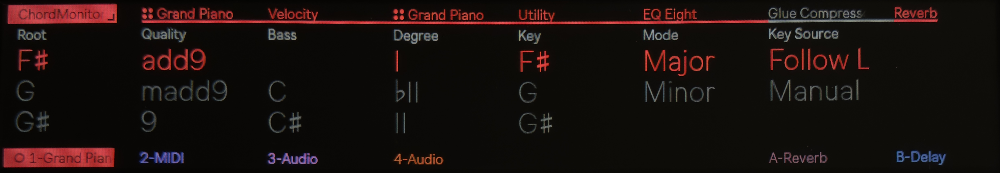

# ChordMonitor++

Max for Live MIDI device. Names the chord you play, including inversions, spread and doubled
voicings and chords with omitted notes, lists other readings of the same notes, and shows the
chord's degree in the key of your Live Set. 

Runs in Ableton Live and on Push 3 standalone.

Based on ollygs ["Chord Monitor for Push Display 1.0"](https://maxforlive.com/library/device/10381/chord-monitor-for-push-display)

## Changes from the original

- **Chord lookup:** the original rotates the held notes and matches each rotation against
  about 65 chord types. ChordMonitor++ looks up a pre-generated table instead. The table covers
  every pitch-class set relative to the bass (2047 entries) and gives up to four readings per
  set, best first.
- **No gaps:** every note combination gets a name, `?` if nothing fits. The original shows
  nothing when no type matches exactly.
- **Inversions:** chords with a note other than the root in the bass are shown as slash chords,
  e.g. `C/E`. The bass is also a Push parameter.
- **Omitted notes:** incomplete voicings are named, e.g. `7(no5)`, `7(no3)`, `maj7(no5)`,
  `m(maj7)(no5)`.
- **More chord types:** e.g. `dim7`, `m7♭5`, `7sus2`, `m6/9`, `11`, `maj11`, `maj13`, `m13`,
  `13sus4`, `add♭9`, `add♯11`, `maj9♯11`.
- **Cleaned-up names:** duplicate spellings (`M7`/`maj7`, `min`/`m`, `7-5`/`7♭5`, `7+9`/`7♯9`)
  and the `dummy` entry are removed.
- **Two alternatives:** Alt and Alt2 each have their own Root and Quality parameters, and the
  Alt display lists every other reading.
- **Degree (new):** Roman numeral of the chord in a key, also as a Push parameter. The key
  follows the Live Set's scale or is set manually with Key and Mode.
- **Octaves:** a single note held in several octaves is not shown as a chord.

## Download

Get `ChordMonitor++.amxd` from the [latest release](../../releases/latest).

A release is published automatically when a push to `main` carries a version in `VERSION` that
has no release yet; its tag is that version with a `v` prefix, e.g. `v1.1.0`, and its text is
that version's section in [CHANGELOG.md](CHANGELOG.md).

## Installation

### Live

Drop `ChordMonitor++.amxd` on a MIDI track or install it in your `User Library` in a subfolder, e.g.: `User Library -> Presets -> Max for Live -> ChordMonitor++`. 

### Push 3 standalone

1. Connect Push and your computer to the same network
2. In Live's browser, open **Places** > **Push**, click **Connect** and enter the six-digit
   code shown on Push.
3. Drag `ChordMonitor++.amxd` onto the **Push** entry in Live's browser, or create a subfolder in `User Library -> Presets -> Max for Live -> ChordMonitor++`.
4. On Push, load it onto a MIDI track from the User Library.

## Display

| Area | Content |
|------|---------|
| Chord | Best name, e.g. `C7`, `C7/E`, `C7(no5)` |
| Alt | Other readings of the same notes, e.g. `C6/A` |
| Key Source | `Follow Live` uses the Set's scale, `Manual` the Key and Mode menus |
| Key / Mode | Key used for the degree |
| Degree | Roman numeral, e.g. `V7`, `ii7`, `viiø7`, `♭VII` |
| Notes | Held notes |

## Push parameter banks

| Bank | Parameters |
|------|------------|
| 1 Chord | Root, Quality, Bass, Degree, Key, Mode, Key Source |
| 2 Alternatives | Alt Root, Alt Quality, Alt2 Root, Alt2 Quality |

The chord parameters (Root, Quality, Bass, Degree and the Alt ones) are read only: turning them
snaps back to the detected chord. Turning Key sets the key for this device only, switches Key
Source to `Manual` and keeps the current mode; the Live Set's scale is not changed. Mode can be
changed only with Key Source on `Manual`. Set Key Source back to `Follow Live` to use the Set's
scale again.
